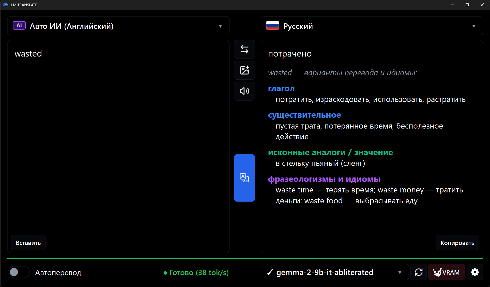

<div align="center">

# 🌐 LLM Translate `v3.5.0`

### Локальный ИИ-переводчик текста и изображений на базе LM Studio с веб-интерфейсом для ПК и смартфонов

**🇷🇺 Русский** | [🇺🇸 English](README_EN.md)

<br/>

[](https://github.com/masyaprogg1488-oss/LLMTranslate/releases)
[](https://www.gnu.org/licenses/gpl-3.0)
[](https://python.org)
[%20%2B%20Web%20UI-41CD52.svg?logo=qt&logoColor=white)](https://doc.qt.io/qtforpython-6/)
[](https://lmstudio.ai)
[](#)

*100% приватность данных, отсутствие подписок, перевод длинных текстов, словарных слов и скриншотов полностью локально — на ПК и телефоне в вашей сети.*

<br/>

<p align="center">
  
</p>

</div>

---

## 💡 О проекте

Онлайн-переводчики отправляют весь ваш текст и скриншоты на сторонние облачные серверы, что неприемлемо при работе с исходным кодом, закрытой документацией, коммерческой тайной или личной перепиской. Кроме того, многие сервисы имеют лимиты по символам, требуют подписку или недоступны в ряде регионов.

**LLM Translate** объединяет современные локальные языковые и мультимодальные модели (**Gemma 4**, **Gemma 3**, **Gemma 2**, **Qwen 3 / Qwen 2.5-VL** и др.) с быстрым интерфейсом на **PySide6 (Qt6)** и встроенным **локальным веб-сервером** для перевода с телефона или планшета по Wi-Fi. Приложение общается напрямую с вашим локальным сервером **[LM Studio](https://lmstudio.ai)** (`http://127.0.0.1:1234`), поэтому **ни один байт данных не покидает вашу локальную сеть**.

---

## ⚙️ Важно: настройка `PATH` для полной автоматизации

Чтобы **LLM Translate** мог сам запускать сервер LM Studio в фоне, автоматически выгружать предыдущую модель из видеопамяти (`VRAM`) при переключении на новую и освобождать память при выходе, убедитесь, что в системной переменной **`PATH`** доступны:

1. **LM Studio CLI (`lms`)** — управляет запуском сервера (`lms server start`), загрузкой (`lms load`) и выгрузкой моделей из VRAM (`lms unload`).
   * **Как добавить в `PATH`:** откройте **LM Studio** → нажмите `Ctrl + Shift + P` (`Cmd + Shift + P` на macOS) → выполните **`Install LM Studio CLI (lms)`**, либо запустите в терминале:
     ```bash
     # Windows (PowerShell)
     ~/.lmstudio/bin/lms.exe bootstrap

     # Linux / macOS
     ~/.lmstudio/bin/lms bootstrap
     ```
   * Перезапустите терминал и проверьте работу командой `lms status`.
2. **Python 3.10+ и `pip`** *(если запускаете из `.py` или собираете билд через PyInstaller)*:
   * При установке Python на Windows отметьте галочку **`Add python.exe to PATH`** на первом экране установщика.

---

## 🎯 Какие модели выбирать под вашу видеокарту (VRAM)

Для максимальной скорости (`tok/s`) модель вместе с контекстом (`KV-кэш`) должна **целиком помещаться в видеопамять (VRAM)**. Если модель выходит за предел доступной VRAM, часть слоёв сбрасывается в системную ОЗУ, и скорость падает в 5–10 раз.

> **Почему мы рекомендуем линейку `Gemma 4 IT QAT`:**
> Модели **Gemma 4** с **QAT** (*Quantization-Aware Training* — квантование, заложенное прямо в процесс обучения) практически не теряют точность по сравнению с `bfloat16`, отлично понимают строгую XML-разметку промптов программы (`<lang>`, `<main>`, `<dict>`), не «плывут» на длинных текстах и редких языках (включая латынь, старославянский и др.) и при этом **в одной модели сочетают перевод текста и распознавание картинок (Vision)**.

> **Учитывайте расход памяти ОС:** на видеокарте с **8 ГБ VRAM** сама система, браузер и мессенджеры уже занимают **~1–1.5 ГБ**, оставляя под модель **~6.5–7 ГБ** (а во время тяжёлой игры — **~3.5–4.5 ГБ**).

| Объём VRAM | С запасом (открыт браузер / игры, ~50–60% VRAM) | Почти впритык по максимуму (вся VRAM под перевод, без сброса в ОЗУ) | Vision-модель (для перевода фото и скриншотов) |
| :--- | :--- | :--- | :--- |
| **4 ГБ VRAM** | **`gemma-4-e2b-it-qat` (`Q4_K_M`, ~1.6–2.0 ГБ)** или **`gemma-2-2b-it` (`Q4_K_M`, ~1.7 ГБ)**<br>Молниеносный отклик, чётко соблюдает структуру словаря и не сыплет мусорными токенами. | **`gemma-3-4b-it-qat` (`Q4_K_M`, ~2.8 ГБ)** или **`gemma-4-e2b-it-qat` (`Q8_0`, ~2.8 ГБ)**<br>Максимум качества и понимания контекста, который гарантированно влезает в 4 ГБ. | **`gemma-4-e2b-it-qat`** или **`qwen2.5-vl-3b-instruct` (`Q4_K_M`, ~2.4 ГБ)**<br>Читают и переводят скриншоты без вылета за лимит 4 ГБ. |
| **8 ГБ VRAM** | **`gemma-3-4b-it-qat` (`Q4_K_M`, ~2.8–3.1 ГБ)** или **`qwen3-4b-instruct` (`Q4_K_M`, ~2.7 ГБ)**<br>Отличный вариант на каждый день: остаётся ~3.5–4 ГБ свободными под браузер, систему и фоновые задачи. | ⭐ **`gemma-4-e4b-it-qat` (~5.5–6.2 ГБ)** или **`gemma-2-9b-it` (`Q4_K_M` / `Q5_K_M`, ~5.8–6.4 ГБ)**<br>**`gemma-4-e4b-it-qat` — лучший выбор под 8 ГБ VRAM:** встаёт почти впритык без свопа в ОЗУ, по интеллекту, словарю и редким языкам наравне с `gemma-2-9b-it`, но ощутимо быстрее по `tok/s` и сразу включает Vision! | ⭐ **`gemma-4-e4b-it-qat`** *(одна модель и на текст, и на фото!)* или **`qwen2.5-vl-3b-instruct` (`Q4_K_M`, ~2.4 ГБ)** |
| **12 ГБ VRAM** | **`gemma-4-e4b-it-qat` (~5.8 ГБ)** или **`gemma-2-9b-it` (`Q5_K_M`, ~6.4 ГБ)**<br>Высокая скорость и точность с огромным запасом видеопамяти под большой контекст. | **`gemma-4-12b-it-qat` (`Q4_K_M` / `Q5_K_M`, ~7.2–8.5 ГБ)** или **`gemma-3-12b-it-qat` (`Q4_K_M`, ~7.8 ГБ)**<br>Глубокое понимание идиом, сленга, художественных и сложных технических текстов без потери форматирования. | **`gemma-4-12b-it-qat`** или **`qwen2.5-vl-7b-instruct` (`Q4_K_M`, ~5.2 ГБ)**<br>Универсальное решение: и текст, и мелкий шрифт на скриншотах в одной модели. |
| **16 ГБ+ VRAM** | **`gemma-4-12b-it-qat` (`Q6_K` / `Q8_0`, ~9.8–12 ГБ)** или **`qwen3-14b-instruct` / `gpt-oss-20b` (`Q4_K_M`, ~9.0 ГБ)**<br>Почти неквантованное качество с запасом памяти под огромные тексты и Vision. | **`gemma-4-26b-a4b-it-qat` (`Q4_K_M`, ~14.4 ГБ, MoE)** или **`gemma-3-27b-it-qat` (`IQ3_M` / `Q4_K_M`, ~12.5–15 ГБ)**<br>`26B A4B` активирует всего ~4B параметров на токен: скорость лёгкой модели при интеллекте 26B. | **`gemma-4-12b-it-qat`** / **`gemma-4-26b-a4b-it-qat`** или **`qwen2.5-vl-7b-instruct` (`Q5_K_M`, ~6.2 ГБ)** |

---

## ⚡ Быстрый старт

1. Скачайте готовый `LLMTranslate.exe` из раздела **[Releases](https://github.com/masyaprogg1488-oss/LLMTranslate/releases)** (или запустите `python llm_trans_latest.py`).
2. Установите **[LM Studio](https://lmstudio.ai)**, активируйте `lms` в `PATH` и скачайте подходящую модель из таблицы выше (например, **`gemma-4-e4b-it-qat`** для 8 ГБ VRAM).
3. Запустите **LLM Translate**:
   * При первом запуске программа автоматически подхватит **системную тему вашей ОС** (тёмную или светлую) и сохранит её в `config.json`.
   * Если сервер LM Studio ещё не запущен, приложение поднимет его автоматически или позволит включить кнопкой **«Server» / «Сервер»**.

---

## ✨ Ключевые возможности `v3.5.0`

### 🧠 Умный перевод, длинные тексты и подавление лишних размышлений
* **Два режима автоопределения языка:**
  * **Auto Detect (AI) / Автоопределение (ИИ)** — распознаёт язык по лексике и грамматике (безошибочно отличает латынь, итальянский, французский, английский и др. языки с общей письменностью).
  * **Auto Detect (Fast) / Автоопределение (Быстрое)** — мгновенное определение по алфавиту и характерным маркерам ещё до обращения к модели.
* **Предупреждение о неверно выбранном языке (для текста и фото):** если вручную выбран один исходный язык (например, английский), но введён текст или загружен скриншот на другом языке (например, на немецком или латыни), программа покажет заметное предупреждение и выполнит перевод с истинного языка.
* **Быстрое переключение языков сверху:** кнопка обмена языков (`⇄`) расположена прямо между выпадающими списками исходного и целевого языков.
* **Умное управление режимом размышлений (`Thinking Mode`):**
  * Когда тумблер **выключен**, программа принудительно отключает рассуждения на уровне API и шаблона (`reasoning_effort="none"`, `enable_thinking=False`, `/no_think`, фильтрация `<|thought|>` в Gemma 4 и `<think>` в Qwen3/DeepSeek), чтобы модель переводила мгновенно.
  * Когда тумблер **включён**, отображается фаза рассуждений с живым таймером и скоростью `tok/s`, а мысли аккуратно отделяются от итогового перевода.
* **Полная поддержка Markdown и длинных текстов:** сохраняются `# заголовки`, `**жирный**`, `*курсив*`, `***жирный курсив***`, `~~зачёркнутый~~`, `++подчёркнутый++`, `` `инлайн-код` ``, ```` ```блоки кода``` ````, `> цитаты` и списки. Длинные тексты автоматически разбиваются на части по абзацам и предложениям с индикацией прогресса `[1/N]`.

### 🖼️ Перевод по фото (OCR + Vision) и полноэкранный просмотр до пикселя
* **Вставка в один клик:** прикрепляйте скриншоты через `Ctrl + V` (`Cmd + V`) прямо из буфера обмена или выбирайте файл кнопкой картинки.
* **Автоблокировка текстового поля при выборе фото:** пока прикреплена картинка, текстовое поле блокируется и полностью игнорируется, чтобы старый текст в поле не мешал переводу изображения. Как только вы убираете фото кнопкой **`✕`**, текстовое поле сразу разблокируется с сохранением прежнего текста.
* **Интерактивный предпросмотр на весь экран (Десктоп + Веб):**
  * Нажмите на мини-превью прикреплённого фото, чтобы открыть полноэкранный просмотр с плавной анимацией.
  * **Масштабирование от `1 пикселя` до отдельных пикселей:** крутите колесо мыши, чтобы отдалить картинку со `100%` вплоть до `1px` на экране или приблизить до `2400%+` — при сильном приближении автоматически включается чёткий попиксельный рендер без размытия!
  * Перетаскивайте фото зажатой ЛКМ (или жестами pinch-to-zoom на телефоне), сбрасывайте масштаб кликом по синей плашке **`100%`** (или клавишей `0`) и закрывайте просмотр кнопкой **`✕`**, клавишей `Esc` или кликом по свободному тёмному полю вокруг картинки.
  * Окно предпросмотра автоматически адаптируется под рабочую область экрана (`availableGeometry`), учитывая панель задач Windows сверху/снизу/сбоку, Dock и Menu Bar на macOS и панели на Linux.
* **Защита от промпт-инъекций и пустых картинок:** модель строго переводит текст на фото, не отвечает на вопросы с картинки и не начинает описывать пейзажи или предметы, если на изображении вообще нет текста (`⚠ На изображении текст не распознан`).

### 📱 Встроенный веб-сервер (Телефон и ПК в локальной сети)
* Включается одним тумблером **«Веб-сервер (Телефон / ПК)»** прямо в настройках программы (по умолчанию порт `7860`) и корректно выключается при закрытии приложения.
* **Дизайн 1:1 с десктопной программой:** те же темы (**Dark**, **AMOLED**, **Light**), масштаб DPI (`75%`–`200%`), кастомные иконки, флаги, умный поиск языков с транслитерацией и раскладкой, контекстное меню, словарь и потоковая печать.
* **Адаптивная вёрстка:**
  * **На ПК в браузере:** классический вид — исходный текст слева, перевод справа, кнопка свапа между языками сверху.
  * **На смартфоне:** вертикальный вид на весь экран — два языка сверху с аккуратным зазором, исходный текст/фото сверху, панель действий с повёрнутой на `90°` кнопкой свапа посередине и перевод снизу (плюс контекстное меню по долгому нажатию).
* **Гостевой режим и память браузера:** на телефоне не нужно настраивать модели — веб-интерфейс автоматически использует выбранную на ПК модель, а личные настройки темы, языка, автоперевода и масштаба сохраняются на самом устройстве (`localStorage` + `Cookie` + `Cache API`).

### 📚 Словарный режим (Dictionary Mode)
При переводе отдельных слов и коротких словосочетаний (до 5–6 слов) программа автоматически включает режим словаря с fallback-догрузкой синонимов:
1. **Основной перевод** в `<main>`.
2. **Синонимы по частям речи** (`[существительное]`, `[глагол]`, `[прилагательное]`, `[наречие]` и др.).
3. **Исконные аналоги и толкования** для сленга и редких терминов.
4. **Фразеологизмы, идиомы и примеры употребления.**

### 🔄 Интеграция с GitHub, системная тема и кроссплатформенность
* **Полная поддержка Windows, Linux и macOS:** нативные системные шрифты, пути LM Studio, горячие клавиши (`Ctrl` / `Cmd`) и офлайн-озвучка (Windows PowerShell Speech / macOS `say` / Linux `espeak-ng`, `spd-say`, `ffplay`, `mpv`, `paplay`, `aplay` + Web Speech API в браузере).
* **Системная тема на первый запуск:** автоматически определяет тему ОС (Windows Registry / Qt StyleHints, macOS `AppleInterfaceStyle`, Linux GNOME `gsettings` / KDE `kdeglobals`), сохраняет её в `config.json` и запоминает любой ваш выбор в настройках.
* **Адаптивные иконки и GitHub-обновления:** автоконтраст белых/кастомных PNG-иконок на светлой теме, кнопка репозитория **[GitHub](https://github.com/masyaprogg1488-oss/LLMTranslate)**, семантическая сверка версий (`v3.5.0`), обновление в один клик и резервная докачка иконок/флагов с GitHub.

---

## 🛠 Архитектура решения

```text
┌──────────────────────────────────┐       ┌──────────────────────────────────┐
│   Десктопный GUI (PySide6 Qt6)   │       │ Веб-интерфейс (ПК / Смартфон)    │
│ (Markdown + OCR + Lightbox + TTS)│       │  http://<LAN-IP>:7860 (SSE/REST) │
└────────────────┬─────────────────┘       └─────────────────┬────────────────┘
                 │                                           │
                 └─────────────────────┬─────────────────────┘
                                       │
                         OpenAI-совместимый HTTP API
                                       │
            ┌──────────────────────────▼──────────────────────────┐
            │                  LM Studio Server                   │
            │                http://127.0.0.1:1234                │
            │    ┌───────────────────────────────────────────┐    │
            │    │ Gemma 4 QAT / Gemma 3 / Qwen 3 / Vision   │    │
            │    └───────────────────────────────────────────┘    │
            └──────────────────────────▲──────────────────────────┘
                                       │
                     Управление VRAM через CLI (`lms ps / load / unload`)
```

---

## 💻 Запуск из исходного кода (Windows / Linux / macOS)

### 1. Клонирование и установка зависимостей
```bash
git clone https://github.com/masyaprogg1488-oss/LLMTranslate.git
cd LLMTranslate
pip install PySide6 openai
```

> **Примечание для Linux:** для системной офлайн-озвучки рекомендуется установить `espeak-ng` (или `speech-dispatcher`) и аудиоплеер (`ffmpeg` / `mpv` / `alsa-utils`):
> ```bash
> sudo apt install espeak-ng ffmpeg alsa-utils       # Debian / Ubuntu
> sudo pacman -S espeak-ng ffmpeg alsa-utils         # Arch Linux
> ```

### 2. Запуск
```bash
python llm_trans_latest.py
```

---

## 🎨 Кастомные иконки и сборка в один исполняемый файл (PyInstaller)

При первом запуске с доступом к сети программа кэширует иконки и флаги в системный кэш (`%LOCALAPPDATA%\LLMTranslate\cache` на Windows, `~/Library/Caches/LLMTranslate` на macOS, `~/.cache/llm-translate` на Linux) с резервной загрузкой из репозитория GitHub.

Если вы хотите вшить или использовать **свои иконки (`icons/`, `logo.ico`, `logo.png`)**:
1. Положите свои `.png` или `.svg` иконки в папку `icons/` рядом со скриптом (`swap.png`, `play.png`, `settings.png`, `github.png`, `flags/ru.png` и т.д.). На светлой теме белые иконки автоматически перекрашиваются в контрастный тёмный цвет.
2. Соберите автономный файл командой **PyInstaller** для вашей ОС:

```bash
# Windows (полная сборка в один .exe со всеми иконками и логотипами)
pyinstaller --noconfirm --onefile --windowed --icon="logo.ico" --add-data "logo.ico;." --add-data "logo.png;." --add-data "icons;icons" --name "LLMTranslate" llm_trans_latest.py

# Linux (внимание: на Unix в --add-data используется двоеточие ':' вместо ';')
pyinstaller --noconfirm --onefile --windowed --icon="logo.png" --add-data "logo.ico:." --add-data "logo.png:." --add-data "icons:icons" --name "LLMTranslate" llm_trans_latest.py

# macOS (сборка приложения со всеми ассетами)
pyinstaller --noconfirm --onefile --windowed --icon="logo.png" --add-data "logo.ico:." --add-data "logo.png:." --add-data "icons:icons" --name "LLMTranslate" llm_trans_latest.py
```

---

## ⌨ Горячие клавиши

| Сочетание клавиш | Действие |
| :--- | :--- |
| `Ctrl + Enter` (`Cmd + Enter`) | Принудительный запуск перевода |
| `Ctrl + V` (`Cmd + V`) | Вставить текст или скриншот из буфера обмена |
| `Ctrl + Shift + C` (`Cmd + Shift + C`) | Скопировать чистый перевод (без словаря и предупреждений) |
| `Ctrl + Shift + S` (`Cmd + Shift + S`) | Быстро поменять языки местами (Swap) |
| `Ctrl + C` / `Ctrl + X` / `Ctrl + A` | Копировать / вырезать / выделить весь текст |
| `Колесо мыши` / `+` / `-` / `0` *(в просмотре фото)* | Зум от `1px` до пикселей / сброс масштаба к `100%` |
| `Esc` | Закрыть полноэкранное фото, настройки, список или остановить генерацию |

---

## ⚙ Конфигурация (`config.json`)

Файл настроек создаётся автоматически (рядом с программой на Windows, в `~/Library/Application Support/LLMTranslate/config.json` на macOS и в `~/.config/llm-translate/config.json` на Linux).

По умолчанию при первом запуске без конфига ставится международный английский язык (`"ui_lang": "en"`) и текущая системная тема вашей ОС, но если в `config.json` указано `"ui_lang": "ru"`, программа запустится на русском:

```json
{
  "ui_lang": "en",
  "theme_mode": "dark",
  "ui_scale": 100,
  "src_lang": "Auto AI",
  "tgt_lang": "Russian",
  "model_id": "huihui-gemma-4-e4b-it-qat-unquantized-abliterated",
  "auto_translate": false,
  "enable_thinking": false,
  "vision_model_id": "",
  "smart_search": false,
  "pin_window": false,
  "web_server_enabled": false,
  "web_server_port": 7860
}
```

---

## 📄 Лицензия

Проект распространяется под свободной лицензией **GNU General Public License v3.0 (GPLv3)**.

Вы можете свободно использовать, изучать, изменять и распространять исходный код и производные сборки при условии сохранения открытости кода под той же лицензией GPL v3 (и будем рады, если укажете оригинального автора :p). Полный текст лицензии находится в файле [LICENSE](LICENSE).
