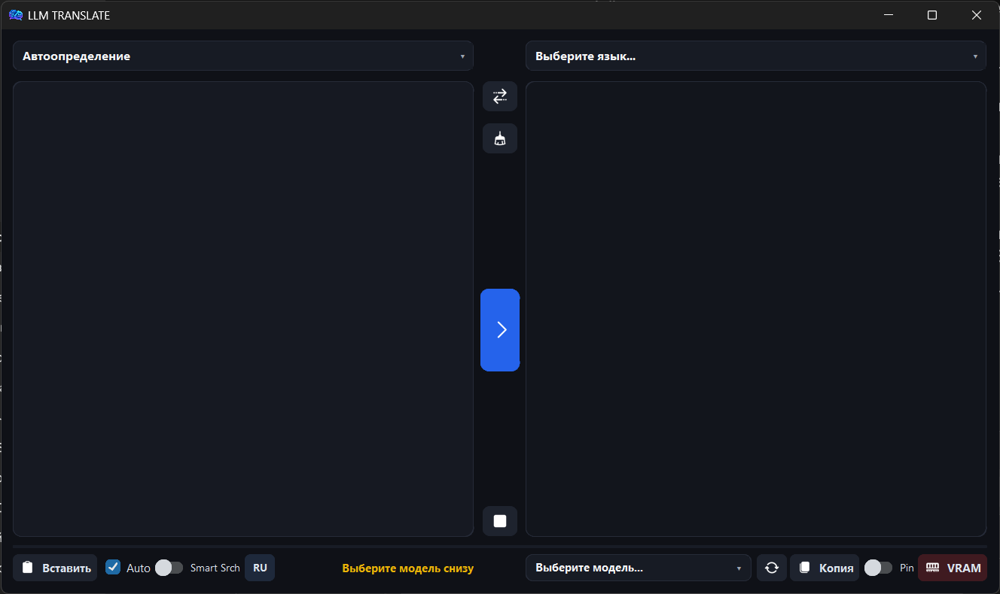

<div align="center">

# 🌐 LLM Translate

### Персональный нейросетевой переводчик на базе локальных LLM моделей через LM Studio

[](https://www.gnu.org/licenses/gpl-3.0)
[](https://python.org)
[](https://github.com/TomSchimansky/CustomTkinter)
[](https://lmstudio.ai)
[](#)

*100% приватность данных, отсутствие подписок, работа без интернета и качество перевода уровня современных генеративных моделей.*

<br/>

<p align="center">
  
</p>

</div>

---

## 💡 Идея проекта

Большинство онлайн-переводчиков (Google Translate, DeepL) отправляют весь вводимый текст на сторонние облачные серверы, что неприемлемо при работе с коммерческой тайной, исходным кодом, конфиденциальной документацией или приватной перепиской.

**LLM Translate** решает эту проблему, объединяя мощь локальных открытых языковых моделей (**Llama 3, Qwen 2.5, DeepSeek, Mistral, Gemma** и др.) с удобством десктопного двухоконного интерфейса переводчика. Приложение взаимодействует с локальным сервером **[LM Studio](https://lmstudio.ai)** по стандарту OpenAI-совместимого API (`http://127.0.0.1:1234`), гарантируя, что **ни один байт вашего текста не покинет ваш компьютер**.

А еще DeepL недоступен на территории РФ, и сама идея переводить с помощью ИИ очень хороша для стерания языкового барьера!

---

## ⚡ Быстрый старт (Windows .EXE)

Если вы скачали готовый скомпилированный релиз:

1. Скачайте архив с файлом `LLM_Translate.exe` из раздела **[Releases](../../releases)**.
2. Убедитесь, что запущен **LM Studio** с включённым сервером на порту `1234` (или просто нажмите кнопку **«Сервер»** внутри переводчика).
3. Запустите `LLM_Translate.exe`. Приложение готово к переводу без установки Python и зависимостей!

( Рекомендую использовать gemma-2-9b-it-abliterated-Q5_K_M, самая стабильная ~8ГБ модель )

---

## ✨ Ключевые возможности и функции

### 🧠 Интеллектуальный перевод и полировка текста
* **Автоматическое распознавание языка (Auto Detect):** модель самостоятельно определяет исходный язык и сообщает его интерфейсу.
* **Защита от несоответствия языков:** если выбран конкретный исходный язык (например, английский), но введён текст на другом (например, немецком), приложение выведет предупреждающий баннер и переведет с фактически распознанного языка.
* **Сохранение Markdown и разметки:** синтаксис `**жирный**`, `*курсив*`, `~~зачёркнутый~~`, `++подчёркнутый++`, `кодовые блоки` и цитаты сохраняются и корректно переносятся в перевод.
* **Автоматическая постобработка (Polishing):** двухэтапный алгоритм проверяет результат на артефакты генерации, языковые склейки (смешение кириллицы и латиницы) и непереведённые термины, автоматически отправляя проблемные участки на доработку.
* **Строгая политика эмодзи:** модель не выдумывает эмодзи от себя, сохраняя их только в случае их наличия в исходном тексте.

### 📚 Интеллектуальный режим словаря (Dictionary Mode)
При вводе отдельных слов или коротких идиом (до 6 слов) приложение автоматически переключается в лексикографический режим:
1. **Основной перевод:** наиболее точный эквивалент с учётом части речи и контекста.
2. **Части речи:** группировка вариантов перевода (`существительное`, `глагол`, `прилагательное` и др.).
3. **Исконные аналоги для сленга и англицизмов:** раскрытие значений заимствованных слов (например, *cringe*, *vibe*, *deadline*) понятным нативным языком.
4. **Фразеологизмы и устойчивые выражения:** подбор релевантных идиом целевого языка.

### ⚡ Производительность и эргономика интерфейса
* **Потоковый вывод (Streaming) с анимацией Typewriter:** текст печатается плавно по мере генерации токенов с возможностью моментального раскрытия по кнопке **«⚡ Ответить сразу»**.
* **Индикация скорости:** вывод реальной скорости генерации в токенах в секунду (`tok/s`), разделение фаз `ИИ размышляет` (Reasoning / `<think>`) и `Печатает`.
* **Управление видеопамятью (VRAM):**
  * Кнопка **VRAM** для принудительной выгрузки модели из видеопамяти в один клик.
  * Автоматическая очистка VRAM перед выходом из программы.
  * Индикация уже загруженных в память моделей (префикс `✓`).
* **Управление сервером:** автоматическое обнаружение `lms` и запуск сервера прямо из окна программы.
* **Умный поиск (Smart Srch):** поиск по 100+ языкам и моделям с поддержкой фонетического набора (транслита) и автоисправления раскладки клавиатуры.
* **Закрепление окна (Pin):** переключатель фиксации окна поверх всех остальных программ для комфортной работы с документами.
* **Двуязычный интерфейс:** переключение всего интерфейса (RU / EN) одной кнопкой.

---

## 🛠 Архитектура решения

```
┌────────────────────────────────────────────────────────┐
│                   LLM Translate GUI                    │
│     (CustomTkinter + Markdown Engine + Typewriter)     │
└──────────────────────────┬─────────────────────────────┘
                           │ 
             HTTP / REST (OpenAI Standard API)
                           │
┌──────────────────────────▼─────────────────────────────┐
│                    LM Studio Server                    │
│                 http://127.0.0.1:1234                  │
│       ┌────────────────────────────────────────┐       │
│       │  Gemma / Qwen-2.5 / Mistral / DeepSeek │       │
│       └────────────────────────────────────────┘       │
└──────────────────────────▲─────────────────────────────┘
                           │
             Управление через CLI (`lms ps`, `lms unload`)
```

---

## 📋 Системные требования

* **ОС:** Windows 10/11, Linux (X11 / Wayland)
* **LM Studio:** актуальная версия с настроенным локальным сервером на порт 1234(+ Нужен lm studio в PATH для автоматизации).
* *(Для сборки из исходников)*: Python 3.8+
* **Первый запуск с ВПН!!**(необязательно)

---

## 💻 Установка из исходного кода

### 1. Клонирование репозитория
```bash
git clone https://github.com/your-username/llm-translate.git
cd llm-translate
```

### 2. Установка зависимостей
```bash
pip install -r requirements.txt
```

> **Примечание для Linux:** Для поддержки системного буфера обмена рекомендуется установить `xclip` или `wl-clipboard`:
> ```bash
> sudo apt install xclip wl-clipboard   # Debian / Ubuntu
> sudo pacman -S xclip wl-clipboard     # Arch Linux
> ```

### 3. Запуск скрипта
```bash
python llm_trans_latest.py
```

---

## ⌨ Горячие клавиши

| Сочетание клавиш | Описание |
| :--- | :--- |
| `Ctrl + Enter` | Принудительный запуск перевода |
| `Ctrl + V` | Вставить текст в позицию курсора |
| `Ctrl + C` | Копировать выделенный текст (или весь перевод, если курсор в поле вывода) |
| `Ctrl + X` | Вырезать текст |
| `Ctrl + A` | Выделить весь текст |
| `Ctrl + Z` / `Ctrl + Y` | Отмена / повтор ввода |
| `Esc` | Закрыть выпадающие меню и подсказки |

---

## ⚙ Конфигурация (`config.json`)

Файл `config.json` генерируется автоматически в папке приложения и сохраняется на выходе:
```json
{
  "ui_lang": "ru",
  "src_lang": "Auto Detect",
  "tgt_lang": "Russian",
  "model_id": "gemma-2-9b-it-abliterated",
  "auto_translate": true,
  "smart_search": false,
  "pin_window": false
}
```

---

## 📄 Лицензия

Проект распространяется под свободной лицензией **GNU General Public License v3.0 (GPLv3)**.

Вы имеете право свободно использовать, изменять и распространять исходный код и производные программы при условии сохранения открытости кода под той же лицензией GPL v3.

Полный текст лицензии доступен в файле [LICENSE](LICENSE) или на сайте [GNU Operating System](https://www.gnu.org/licenses/gpl-3.0.html).
