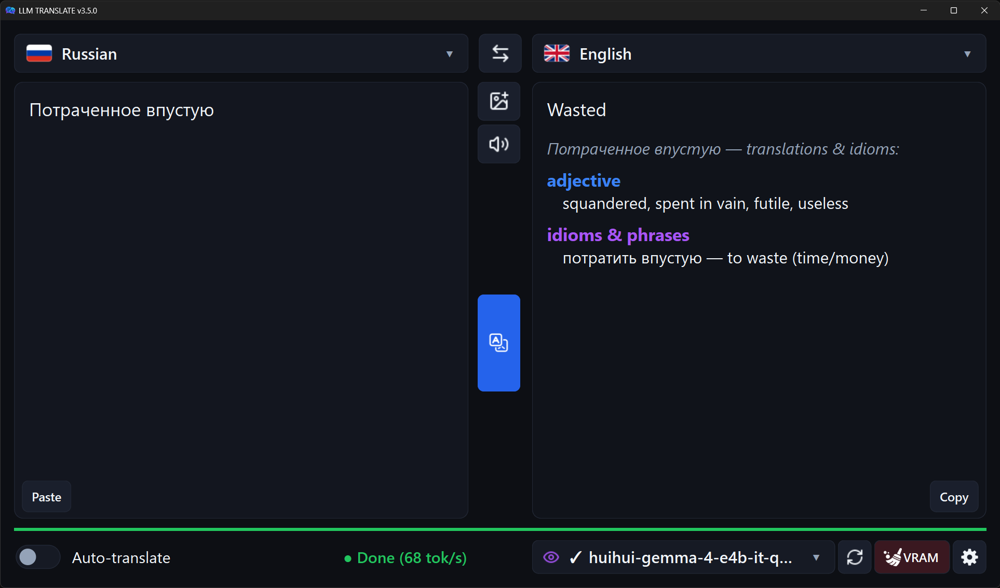

<div align="center">

# 🌐 LLM Translate `v3.5.0`

### Local AI Text & Image Translator Powered by LM Studio with Built-in Web UI for PC & Smartphones

[🇷🇺 Русский](README.md) | **🇺🇸 English**

<br/>

[](https://github.com/masyaprogg1488-oss/LLMTranslate/releases)
[](https://www.gnu.org/licenses/gpl-3.0)
[](https://python.org)
[%20%2B%20Web%20UI-41CD52.svg?logo=qt&logoColor=white)](https://doc.qt.io/qtforpython-6/)
[](https://lmstudio.ai)
[](#)

*100% data privacy, zero subscriptions, offline translation of long texts, dictionary terms, and screenshots — on your desktop and across your devices over local Wi-Fi.*

<br/>

<p align="center">
  
</p>

</div>

---

## 💡 Overview

Cloud translation services send every word and screenshot you paste to third-party servers—a dealbreaker when working with proprietary source code, confidential documents, NDAs, or private chats. Many online tools also impose strict character limits, require paid subscriptions, or are region-locked.

**LLM Translate** pairs modern open-weight language and multimodal models (**Gemma 4**, **Gemma 3**, **Gemma 2**, **Qwen 3 / Qwen 2.5-VL**, etc.) with a native **PySide6 (Qt6)** desktop app and a built-in **responsive Web Server** for translating from your phone or tablet on your local network. It connects directly to your local **[LM Studio](https://lmstudio.ai)** server (`http://127.0.0.1:1234`), so **not a single byte of your data ever leaves your local network**.

---

## ⚙️ Important: Add LM Studio CLI (`lms`) & Python to `PATH`

For **full automation**—allowing LLM Translate to boot the local server in the background, automatically unload the previous model from `VRAM` when switching models, and free GPU memory on exit—make sure these tools are in your system **`PATH`**:

1. **LM Studio CLI (`lms`)** — handles background server startup (`lms server start`), model loading (`lms load`), and VRAM cleanup (`lms unload`).
   * **How to add to `PATH`:** open **LM Studio** → press `Ctrl + Shift + P` (`Cmd + Shift + P` on macOS) → run **`Install LM Studio CLI (lms)`**, or run in your terminal:
     ```bash
     # Windows (PowerShell)
     ~/.lmstudio/bin/lms.exe bootstrap

     # Linux / macOS
     ~/.lmstudio/bin/lms bootstrap
     ```
   * Restart your terminal and verify with `lms status`.
2. **Python 3.10+ & `pip`** *(if running from `.py` source or building an executable)*:
   * When installing Python on Windows, check **`Add python.exe to PATH`** on the first installer screen.

---

## 🎯 Recommended Models by GPU Memory (VRAM)

For maximum generation speed (`tok/s`), the model and its context (`KV cache`) must **fit entirely inside your GPU's VRAM**. If a model exceeds available VRAM, LM Studio offloads layers to system RAM, reducing speed by 5–10×.

> **Why we recommend the `Gemma 4 IT QAT` family:**
> **Gemma 4** models trained with **QAT** (*Quantization-Aware Training*) retain near-`bfloat16` precision at 4-bit sizes, follow the app's strict XML prompt format (`<lang>`, `<main>`, `<dict>`) without breaking on long passages or rare languages (such as Latin or Old Church Slavonic), and **natively support both Text and Vision (image OCR) in a single model**.

> **Account for OS VRAM overhead:** on an **8 GB VRAM** card, your OS, browser, and background apps already use **~1–1.5 GB**, leaving **~6.5–7 GB** for the model (or **~3.5–4.5 GB** while a heavy game is running).

| GPU VRAM | Comfortable Headroom (browser / games open, ~50–60% VRAM) | Maxed Out / Sweet Spot (dedicated VRAM, zero RAM offloading) | Vision Model (for image & screenshot translation) |
| :--- | :--- | :--- | :--- |
| **4 GB VRAM** | **`gemma-4-e2b-it-qat` (`Q4_K_M`, ~1.6–2.0 GB)** or **`gemma-2-2b-it` (`Q4_K_M`, ~1.7 GB)**<br>Ultra-fast response, follows dictionary formatting cleanly without garbage tokens. | **`gemma-3-4b-it-qat` (`Q4_K_M`, ~2.8 GB)** or **`gemma-4-e2b-it-qat` (`Q8_0`, ~2.8 GB)**<br>Maximum translation & dictionary quality that stays strictly under the 4 GB cap. | **`gemma-4-e2b-it-qat`** or **`qwen2.5-vl-3b-instruct` (`Q4_K_M`, ~2.4 GB)**<br>Accurate screenshot OCR without overflowing 4 GB VRAM. |
| **8 GB VRAM** | **`gemma-3-4b-it-qat` (`Q4_K_M`, ~2.8–3.1 GB)** or **`qwen3-4b-instruct` (`Q4_K_M`, ~2.7 GB)**<br>Great daily driver: leaves ~3.5–4 GB free for your browser, OS, and background tasks. | ⭐ **`gemma-4-e4b-it-qat` (~5.5–6.2 GB)** or **`gemma-2-9b-it` (`Q4_K_M` / `Q5_K_M`, ~5.8–6.4 GB)**<br>**`gemma-4-e4b-it-qat` is the #1 pick for 8 GB VRAM:** fits right inside the 8 GB budget without RAM swap, matches `gemma-2-9b-it` in translation intelligence, dictionary prompts, and rare languages, generates noticeably faster `tok/s`, and includes native Vision! | ⭐ **`gemma-4-e4b-it-qat`** *(handles both text & images in one model!)* or **`qwen2.5-vl-3b-instruct` (`Q4_K_M`, ~2.4 GB)** |
| **12 GB VRAM** | **`gemma-4-e4b-it-qat` (~5.8 GB)** or **`gemma-2-9b-it` (`Q5_K_M`, ~6.4 GB)**<br>High speed and accuracy with plenty of free VRAM for long contexts. | **`gemma-4-12b-it-qat` (`Q4_K_M` / `Q5_K_M`, ~7.2–8.5 GB)** or **`gemma-3-12b-it-qat` (`Q4_K_M`, ~7.8 GB)**<br>Deep grasp of idioms, slang, literary prose, and technical texts with flawless Markdown preservation. | **`gemma-4-12b-it-qat`** or **`qwen2.5-vl-7b-instruct` (`Q4_K_M`, ~5.2 GB)**<br>All-in-one text and dense screenshot OCR in a single model. |
| **16 GB+ VRAM** | **`gemma-4-12b-it-qat` (`Q6_K` / `Q8_0`, ~9.8–12 GB)** or **`qwen3-14b-instruct` (`Q4_K_M`, ~9.0 GB)**<br>Near-lossless precision with generous headroom for huge documents and Vision. | **`gemma-4-26b-a4b-it-qat` (`Q4_K_M`, ~14.4 GB, MoE)** or **`gemma-3-27b-it-qat` (`IQ3_M` / `Q4_K_M`, ~12.5–15 GB)**<br>`26B A4B` activates only ~4B parameters per token—combining small-model speed with 26B intelligence. | **`gemma-4-12b-it-qat`** / **`gemma-4-26b-a4b-it-qat`** or **`qwen2.5-vl-7b-instruct` (`Q5_K_M`, ~6.2 GB)** |

---

## ⚡ Quick Start

1. Download `LLMTranslate.exe` from **[Releases](https://github.com/masyaprogg1488-oss/LLMTranslate/releases)** (or run `python llm_trans_latest.py`).
2. Install **[LM Studio](https://lmstudio.ai)**, add `lms` to `PATH`, and download a recommended model from the table above (for example, **`gemma-4-e4b-it-qat`** for 8 GB GPUs).
3. Launch **LLM Translate**:
   * On first launch, the app automatically detects your **OS system theme** (Dark or Light) and saves it to `config.json`.
   * If the LM Studio local server isn't running yet, the app boots it automatically or lets you start it with the **Server** button.

---

## ✨ Key Features in `v3.5.0`

### 🧠 Smart Translation, Long Texts & Reasoning Control
* **Dual Auto-Detection Modes:**
  * **Auto Detect (AI)** — identifies the true source language from vocabulary and grammar (accurately distinguishing Latin, Italian, French, English, etc. even when sharing the same script).
  * **Auto Detect (Fast)** — instant script and marker recognition before token generation even begins.
* **Wrong-Language Mismatch Warning (Text & Photos):** if you manually select a source language (e.g., English) but enter text or upload an image in another language (e.g., German or Latin), the app warns you and translates from the actual detected language.
* **Top-Bar Language Swap (`⇄`):** positioned right between the source and target language selectors for effortless switching.
* **Strict Thinking Mode Control:**
  * When **Thinking Mode is OFF**, reasoning is actively suppressed via API parameters and templates (`reasoning_effort="none"`, `enable_thinking=False`, `/no_think`, Gemma 4 `<|thought|>` and Qwen3/DeepSeek `<think>` stripping) for instant translation.
  * When **Thinking Mode is ON**, the status bar shows a live reasoning timer and `tok/s` counter while keeping internal thoughts separate from the clean translation.
* **Full Markdown & Long-Text Chunking:** preserves `# headers`, `**bold**`, `*italic*`, `***bold italic***`, `~~strikethrough~~`, `++underline++`, `` `inline code` ``, ```` ```code blocks``` ````, `> quotes`, and lists. Long documents are automatically split along paragraph and sentence boundaries with live `[1/N]` progress.

### 🖼️ Image & Screenshot Translation (OCR + Vision) with Pixel-Level Lightbox
* **Instant Attach:** paste screenshots with `Ctrl + V` (`Cmd + V`) or pick an image file via the toolbar button.
* **Automatic Text Input Lock:** while a photo is attached, the text editor is locked and ignored so leftover text never interferes with image translation. Removing the photo (`✕`) immediately unlocks the text box with your previous text intact.
* **Interactive Fullscreen Photo Preview (Desktop + Web):**
  * Click the mini thumbnail to open a smooth animated fullscreen viewer.
  * **Zoom from `1px` to Individual Pixels:** scroll the mouse wheel to zoom out all the way down to `1px` on screen or zoom in up to `2400%+` (automatically switching to crisp nearest-neighbor pixel rendering at high magnification!).
  * Pan freely by dragging with the left mouse button (or pinch-to-zoom on mobile), click the blue **`100%`** badge (or press `0`) to reset zoom, and exit via **`✕`**, `Esc`, or clicking the empty dark backdrop around the image.
  * Automatically adapts to your monitor's remaining work area (`availableGeometry`), respecting top/bottom/side Windows taskbars, macOS Menu Bar & Dock, and Linux panels.
* **Anti-Injection & No-Text Guard:** strictly translates text inside images without obeying prompt injections written on screenshots and without describing scenery when an image contains no readable text (`⚠ No readable text found in image`).

### 📱 Built-in Web Server (Phone & PC over Local Wi-Fi)
* Enable **Web Server (Phone / PC)** with a single toggle in Settings (default port `7860`); shuts down cleanly when the desktop app closes.
* **1:1 Desktop Design Parity:** supports the same themes (**Dark**, **AMOLED**, **Light**), DPI scaling (`75%`–`200%`), custom icons, flags, smart language search (including keyboard layout & phonetic matching), custom context menus, dictionary mode, and streaming typewriter output.
* **Responsive Desktop & Mobile Layouts:**
  * **Desktop Browser:** side-by-side layout (source on the left, translation on the right, swap button between the two languages at the top).
  * **Smartphone Browser:** full-screen vertical layout (dual language selectors at the top with a clean gap, source text/image on top, action bar with a `90°`-rotated swap icon in the middle, translation on the bottom, plus long-press context menu).
* **Guest-Friendly & Persistent:** mobile guests translate seamlessly using the host PC's active model without model-selector clutter, while each device remembers its own theme, UI language, scale, and preferences via `localStorage`, `Cookie`, and browser `Cache API`.

### 📚 Dictionary Mode
When translating single words or short phrases (up to 5–6 words), the app automatically presents a structured dictionary view with automatic synonym enrichment:
1. **Primary contextual translation** inside `<main>`.
2. **Part-of-speech synonym groups** (`[noun]`, `[verb]`, `[adjective]`, `[adverb]`, etc.).
3. **Native equivalents & definitions** for slang, idioms, and loanwords.
4. **Common expressions & usage examples.**

### 🔄 GitHub Integration, OS Theme Detection & Cross-Platform Support
* **Native Windows, Linux & macOS Support:** platform-tuned fonts, LM Studio discovery paths, shortcuts (`Ctrl` / `Cmd`), and offline TTS fallback (Windows PowerShell Speech / macOS `say` / Linux `espeak-ng`, `spd-say`, `ffplay`, `mpv`, `paplay`, `aplay` + browser Web Speech API).
* **First-Run System Theme Detection:** detects your OS color scheme on first launch (Windows Registry / Qt StyleHints, macOS `AppleInterfaceStyle`, Linux GNOME `gsettings` / KDE `kdeglobals`), saves it to `config.json`, and permanently remembers any manual theme change until `config.json` is deleted.
* **Smart Icon Contrast & GitHub Updates:** auto-tints white custom PNG/SVG icons for contrast on the Light theme, links directly to **[GitHub](https://github.com/masyaprogg1488-oss/LLMTranslate)**, checks semantic versions (`v3.5.0`) for 1-click self-updates, and uses GitHub as a fallback mirror for icons and flags.

---

## 🛠 Architecture

```text
┌──────────────────────────────────┐       ┌──────────────────────────────────┐
│    Desktop GUI (PySide6 Qt6)     │       │   Web UI (PC & Smartphone)       │
│ (Markdown + OCR + Lightbox + TTS)│       │  http://<LAN-IP>:7860 (SSE/REST) │
└────────────────┬─────────────────┘       └─────────────────┬────────────────┘
                 │                                           │
                 └─────────────────────┬─────────────────────┘
                                       │
                          OpenAI-Compatible HTTP API
                                       │
            ┌──────────────────────────▼──────────────────────────┐
            │                  LM Studio Server                   │
            │                http://127.0.0.1:1234                │
            │    ┌───────────────────────────────────────────┐    │
            │    │ Gemma 4 QAT / Gemma 3 / Qwen 3 / Vision   │    │
            │    └───────────────────────────────────────────┘    │
            └──────────────────────────▲──────────────────────────┘
                                       │
                      VRAM Management via CLI (`lms ps / load / unload`)
```

---

## 💻 Running from Source (Windows / Linux / macOS)

### 1. Clone & Install Dependencies
```bash
git clone https://github.com/masyaprogg1488-oss/LLMTranslate.git
cd LLMTranslate
pip install PySide6 openai
```

> **Linux Note:** for offline OS speech synthesis (TTS), install `espeak-ng` (or `speech-dispatcher`) and an audio player (`ffmpeg` / `mpv` / `alsa-utils`):
> ```bash
> sudo apt install espeak-ng ffmpeg alsa-utils       # Debian / Ubuntu
> sudo pacman -S espeak-ng ffmpeg alsa-utils         # Arch Linux
> ```

### 2. Run
```bash
python llm_trans_latest.py
```

---

## 🎨 Custom Icons & Single-File Executable Build (PyInstaller)

On first launch with internet access, the app caches UI icons and flags in the OS cache folder (`%LOCALAPPDATA%\LLMTranslate\cache` on Windows, `~/Library/Caches/LLMTranslate` on macOS, `~/.cache/llm-translate` on Linux) with automatic fallback to the GitHub repository.

If you want to use or bundle **custom icons (`icons/`, `logo.ico`, `logo.png`)**:
1. Place your `.png` or `.svg` files in the `icons/` directory next to the script (`swap.png`, `play.png`, `settings.png`, `github.png`, `flags/gb.png`, etc.). On the Light theme, white icons are automatically tinted dark for crisp contrast.
2. Build a standalone single-file executable with **PyInstaller** for your OS:

```bash
# Windows (single .exe bundling all icons and logos)
pyinstaller --noconfirm --onefile --windowed --icon="logo.ico" --add-data "logo.ico;." --add-data "logo.png;." --add-data "icons;icons" --name "LLMTranslate" llm_trans_latest.py

# Linux (note: Unix uses ':' instead of ';' in --add-data)
pyinstaller --noconfirm --onefile --windowed --icon="logo.png" --add-data "logo.ico:." --add-data "logo.png:." --add-data "icons:icons" --name "LLMTranslate" llm_trans_latest.py

# macOS (standalone bundle with all assets)
pyinstaller --noconfirm --onefile --windowed --icon="logo.png" --add-data "logo.ico:." --add-data "logo.png:." --add-data "icons:icons" --name "LLMTranslate" llm_trans_latest.py
```

---

## ⌨ Keyboard Shortcuts

| Shortcut | Action |
| :--- | :--- |
| `Ctrl + Enter` (`Cmd + Enter`) | Force translate immediately |
| `Ctrl + V` (`Cmd + V`) | Paste text or screenshot from clipboard |
| `Ctrl + Shift + C` (`Cmd + Shift + C`) | Copy clean translation (strips dictionary & warnings) |
| `Ctrl + Shift + S` (`Cmd + Shift + S`) | Swap source & target languages |
| `Ctrl + C` / `Ctrl + X` / `Ctrl + A` | Copy / Cut / Select all text |
| `Mouse Wheel` / `+` / `-` / `0` *(in photo preview)* | Zoom from `1px` to pixel grid / reset zoom to `100%` |
| `Esc` | Close fullscreen photo preview, settings, dropdown, or stop generation |

---

## ⚙ Configuration (`config.json`)

The configuration file is created automatically (next to the executable on Windows, at `~/Library/Application Support/LLMTranslate/config.json` on macOS, and at `~/.config/llm-translate/config.json` on Linux).

By default, a fresh launch without `config.json` starts in English (`"ui_lang": "en"`) and adopts your OS theme (`"dark"` or `"light"`), while respecting `"ui_lang": "ru"` or any custom theme saved in `config.json`:

```json
{
  "ui_lang": "en",
  "theme_mode": "dark",
  "ui_scale": 100,
  "src_lang": "Auto AI",
  "tgt_lang": "Russian",
  "model_id": "huihui-gemma-4-e4b-it-qat-unquantized-abliterated",
  "auto_translate": false,
  "enable_thinking": false,
  "vision_model_id": "",
  "smart_search": false,
  "pin_window": false,
  "web_server_enabled": false,
  "web_server_port": 7860
}
```

---

## 📄 License

Distributed under the **GNU General Public License v3.0 (GPLv3)**.

You are free to use, study, modify, and redistribute the source code and derivative builds under the same GPLv3 license (and crediting the original author is always appreciated :p). See [LICENSE](LICENSE) for full details.
